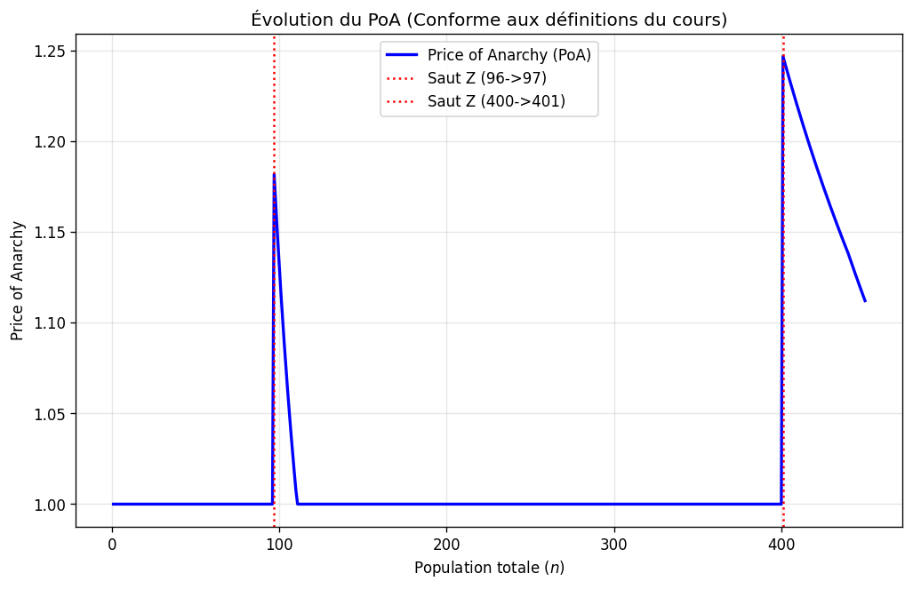
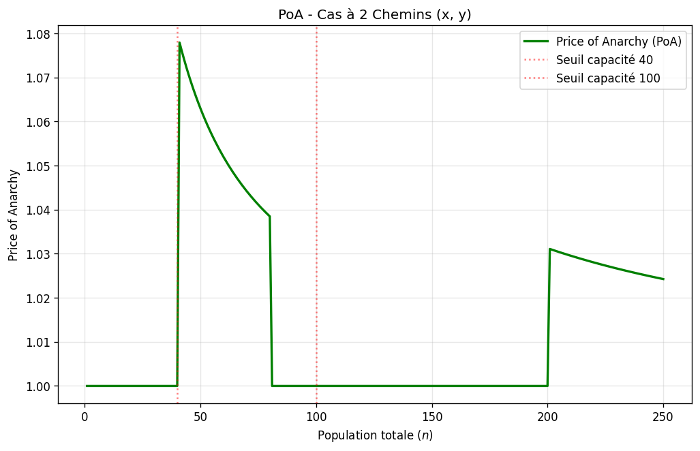

# Saclay transport congestion

An N-player congestion game on the Massy-Palaiseau → Moulon commute on the Saclay plateau:
selfish routing costs at most **25% more than the social optimum** (price of anarchy 1.2466),
and that gap is exactly zero for **386 of 450 population sizes** — inefficiency only appears
in narrow bands around capacity thresholds.

**My contribution:** the game-theoretic modelling and all three scripts in `congestion_game/`.
The SUMO network was built by Mathias Debaud, the open transport data collected by Gabriel
Henry, and the repository set up by Grégoire Filbas--Turpin. Four-person project, Game Theory
course, CentraleSupélec.



## Approach

- **Atomic congestion game.** N commuters each pick one route. Each route has a step latency
  function with capacity thresholds, taken from the project's own route analysis. Every user
  on a route pays that route's latency at the final load.
- **Two solution concepts.** The Nash equilibrium is found by sequential best response — users
  arrive one at a time and each takes the cheapest route available at that moment. The social
  optimum is found by exhaustive search over allocations. The price of anarchy is the ratio of
  the two social costs.
- **Two variants.** Two surface routes first, then three once the line-18 metro is added, with
  its own capacity thresholds at 96 and 400 passengers.
- **Validation.** `verify_equilibrium.py` checks that each greedy allocation really is a Nash
  equilibrium — that no user reduces their cost by switching unilaterally — and that the
  bounded optimum search used in the three-route script matches an exhaustive one.
- **Network model.** A separate SUMO model imports the plateau from OpenStreetMap and
  generates public-transport flows for the Moulon district.

## Results

| Model | PoA = 1 for | Peaks | Max PoA |
|---|---|---|---|
| Two routes | 160 of 250 population sizes | n = 41 | **1.0779** |
| Three routes (with metro) | 386 of 450 population sizes | n = 97 → 1.1817 · n = 401 → 1.2466 | **1.2466** |

The two peaks of the three-route model sit exactly on the metro's capacity thresholds (96 and
400). Below a threshold the selfish equilibrium and the social optimum coincide; crossing it,
the extra passenger pushes everyone onto a more expensive tier and the two diverge.



**How these numbers were checked.** `verify_equilibrium.py` runs two controls and both pass:
no greedy allocation fails the Nash condition (0 failures over n = 1…250 for two routes and
n = 1…450 for three), and the bounded optimum search (`x ≤ 200`, `y ≤ 150`) returns the same
value as a full exhaustive search at every n (0 discrepancies over n = 1…450).

**Network model.** OpenStreetMap extract of the plateau (bounding box 2.1523–2.2639 E,
48.7038–48.7263 N) converted with SUMO 1.25.0: **131 public-transport lines**, **171 stops**,
and **126 flows over 126 routes** generated for a one-hour window with `ptlines2flows.py`
(`-b 0 -e 3600 -p 600`, seed 42).

## Limitations

- **The latency functions are not calibrated.** The step costs come from the project's own
  route analysis, not from measured travel times. Every PoA figure here depends entirely on
  where those thresholds sit — move them and the peaks move with them.
- **No simulation result.** The SUMO run was never completed: the output files produced by the
  team contained zero inserted vehicles, so no travel time or delay figure comes from the
  network model. Those empty outputs are not published here. What is published is the network
  and the demand generation, which do work.
- **Nash is computed, not proved.** Sequential insertion is verified to land on an equilibrium
  across the ranges tested, but that is a check over a finite range, not a proof. The game may
  also admit other equilibria, which this code does not explore.
- **Static and deterministic.** No stochastic demand, no time-of-day profile, no waiting or
  transfer time, and no capacity constraint beyond the step costs themselves.
- **An earlier variant of the model gives PoA = 1 everywhere.** If each user pays the marginal
  cost at the moment they arrive rather than the route's final latency, the selfish equilibrium
  coincides with the social optimum by construction. The figures above use the standard
  convention; the alternative is a different pricing assumption, not a different result.
- **The open data in `data/` is not used by the scripts.** It was collected for the demand
  estimation part of the project and is kept here for completeness.
- **`build.bat` and `run.bat` are Windows batch files.** On macOS or Linux the equivalent
  commands have to be run by hand — they are given below.

## Reproduce

```bash
git clone https://github.com/aliahjyage01/saclay-transport-congestion.git
cd saclay-transport-congestion
python3 -m venv venv && source venv/bin/activate
pip install -r requirements.txt
```

The congestion game needs nothing but numpy and matplotlib:

```bash
python congestion_game/poa_two_paths.py       # two routes; writes PoA_2chemins.png
python congestion_game/poa_three_paths.py     # three routes; opens the figure
python congestion_game/verify_equilibrium.py  # the two checks behind the Results table
```

`verify_equilibrium.py` takes about a minute, the two others a few seconds.

The SUMO part needs SUMO ≥ 1.25 with `SUMO_HOME` set:

```bash
cd sumo_network
python "$SUMO_HOME/tools/ptlines2flows.py" -n osm.net.xml.gz -b 0 -e 3600 -p 600 \
    --random-begin --seed 42 --ptstops osm_stops.add.xml --ptlines osm_ptlines.xml \
    -o osm_pt.rou.xml --ignore-errors --vtype-prefix pt_ --stopinfos-file stopinfos.xml \
    --routes-file vehroutes.xml --trips-file trips.trips.xml --min-stops 0 --extend-to-fringe
sumo-gui -c osm.sumocfg
```

## Data sources

| File | Source |
|---|---|
| `data/trafic-annuel-entrant-par-station-du-reseau-ferre-2021.csv` | Île-de-France Mobilités open data — annual entries per rail station |
| `data/aNqtB55xUNkB1O6s_TCC_trafic_journalier_2024.xlsx` | OMNIL — daily public transport traffic, 2024 |
| `sumo_network/osm_bbox.osm.xml.gz` | OpenStreetMap contributors, ODbL |
